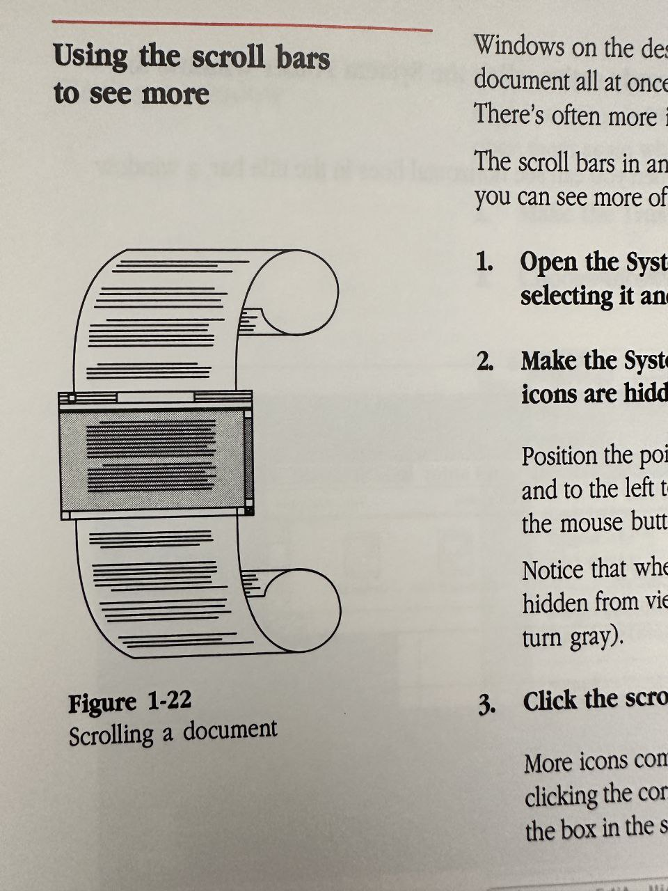

вообще, конечно, сейчас забавно смотреть на то, как [выбирали метафоры](https://twitter.com/kjhealy/status/1583828063921790976?t=XzE5MLObY7g-joTAQ8ZC3g&s=19) для объяснения новых для того времени интерфейсов

теперь настолько всё привычное, что и не задумываешься о таком

но с другой стороны для поколения, которое родилось со смартфонами в руках и при социальных сетях, уже [становятся непонятны концепции](https://www.theverge.com/22684730/students-file-folder-directory-structure-education-gen-z) файлов, директорий и их вложенности, потому что они привыкли к линейной структуре
