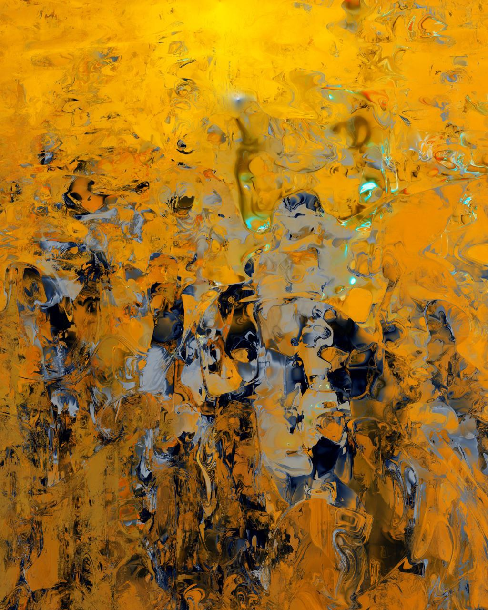
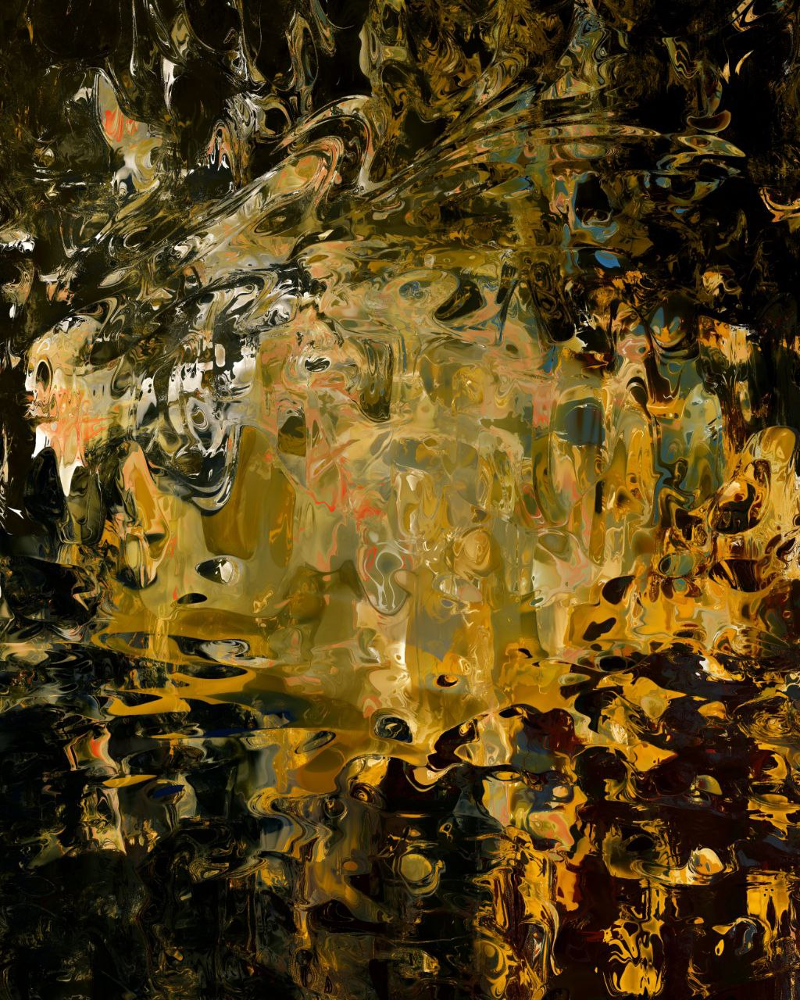
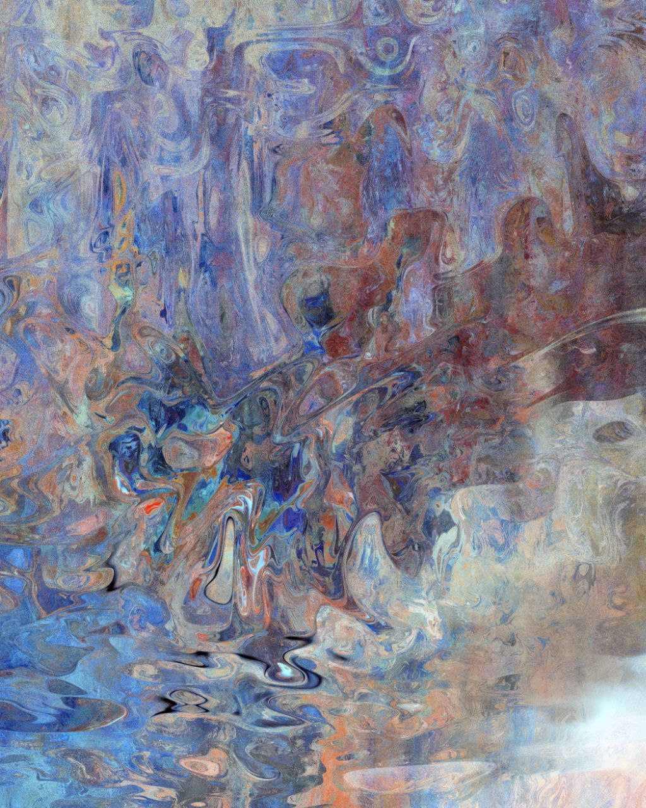
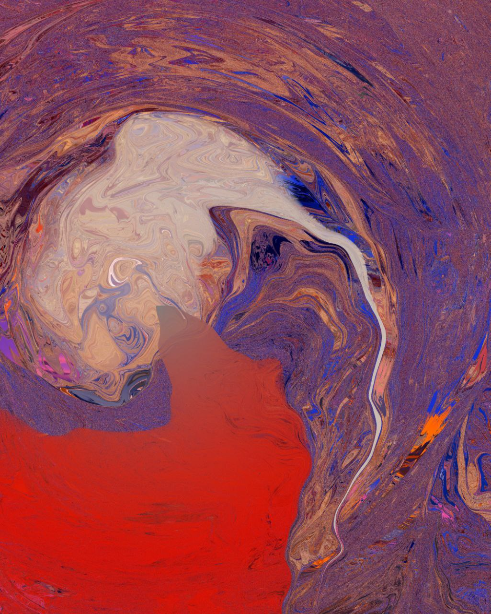

последнее время смотрю в сторону [генеративного арта](https://ru.m.wikipedia.org/wiki/%D0%9F%D1%80%D0%BE%D1%86%D0%B5%D0%B4%D1%83%D1%80%D0%B0%D0%BB%D1%8C%D0%BD%D0%BE%D0%B5_%D0%B8%D1%81%D0%BA%D1%83%D1%81%D1%81%D1%82%D0%B2%D0%BE), и там очень часто видно чёткую геометрию и паттерны

но посмотрите, что делает [Зак Либерман](https://instagram.com/zach.lieberman), для него код это масляная краска
