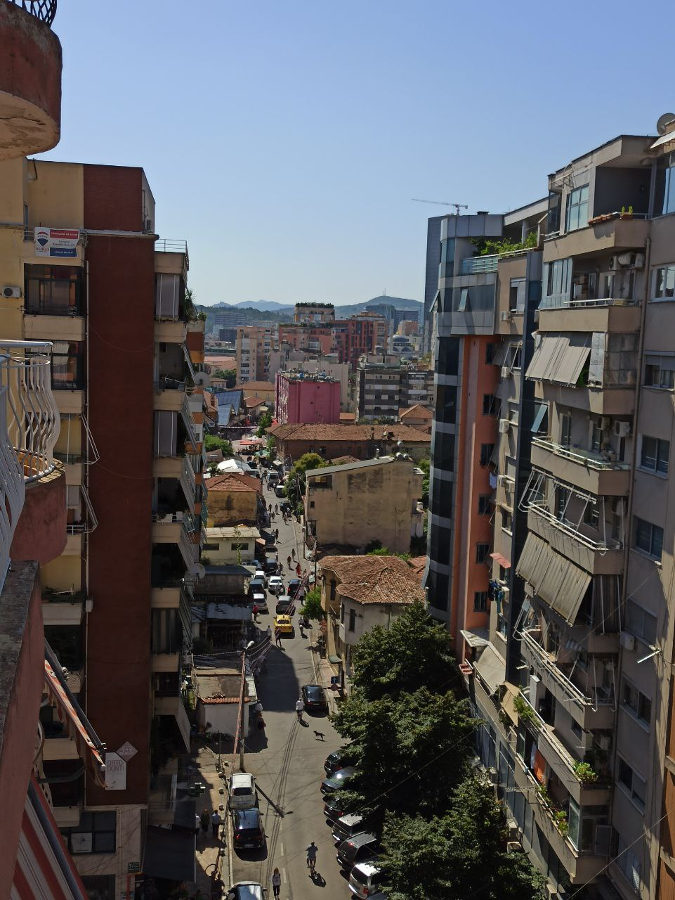

побывал в Албании и там:
- ограничение скорости 40 км/ч по городу
- электротакси и электрополиция
- много велосипедистов
- и много детских площадок
- двери надо толкать, а не тянуть
- первый этаж это нулевой
- в столице ночью в центре очень темно и безлюдно
- и откуда-то кричат петухи
- очень много старых мерседесов
- очень много авторазбора
- курс валюты как в россии
- красивейшие пейзажи

в целом, мне понравилось, но возможно мне просто понравилось хоть где-то ещё побывать, кроме Турции
