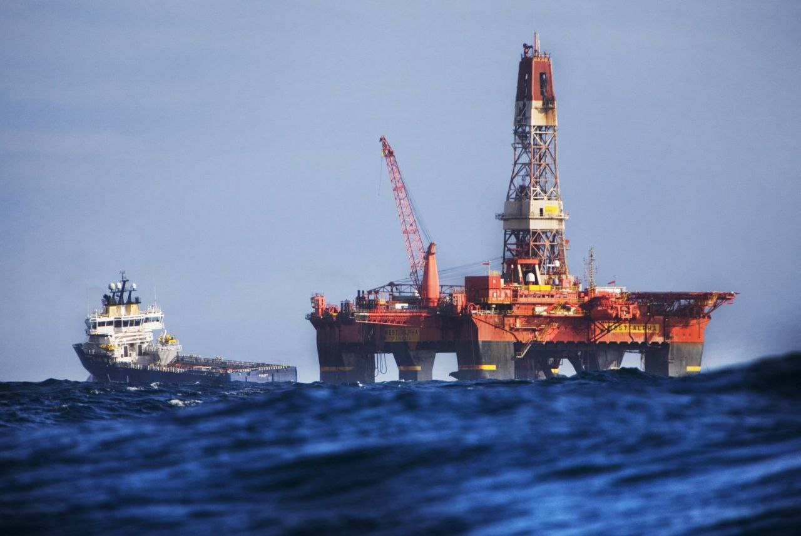
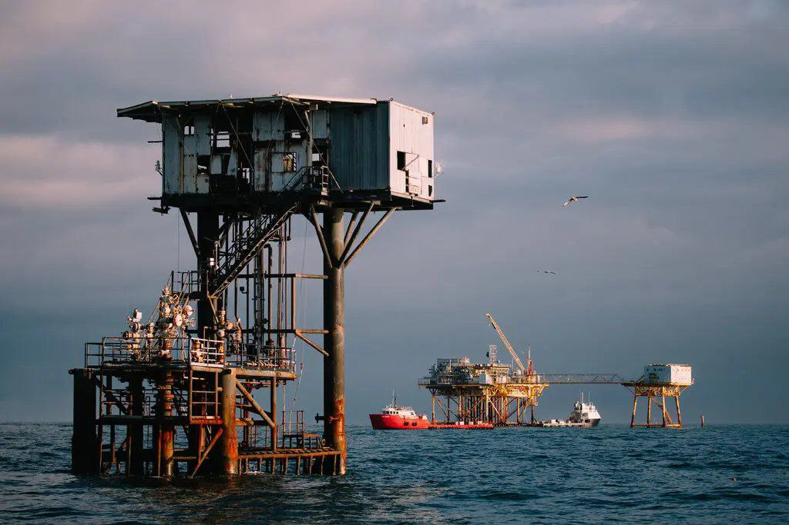
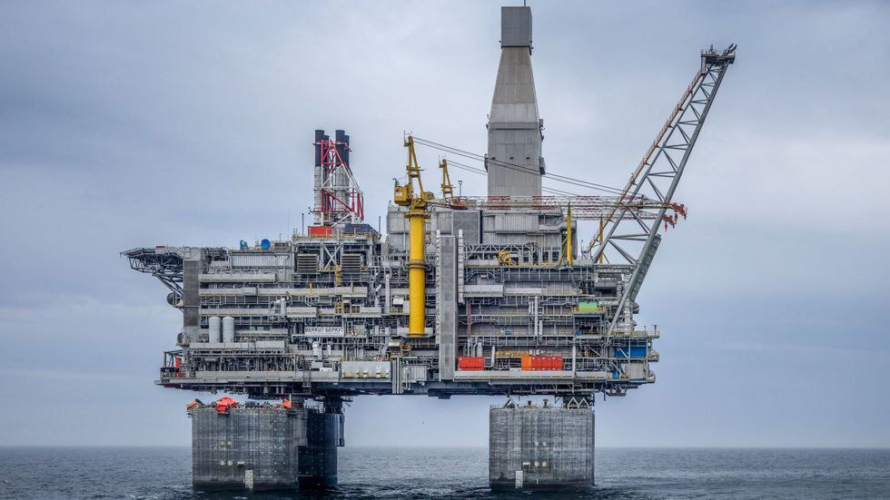
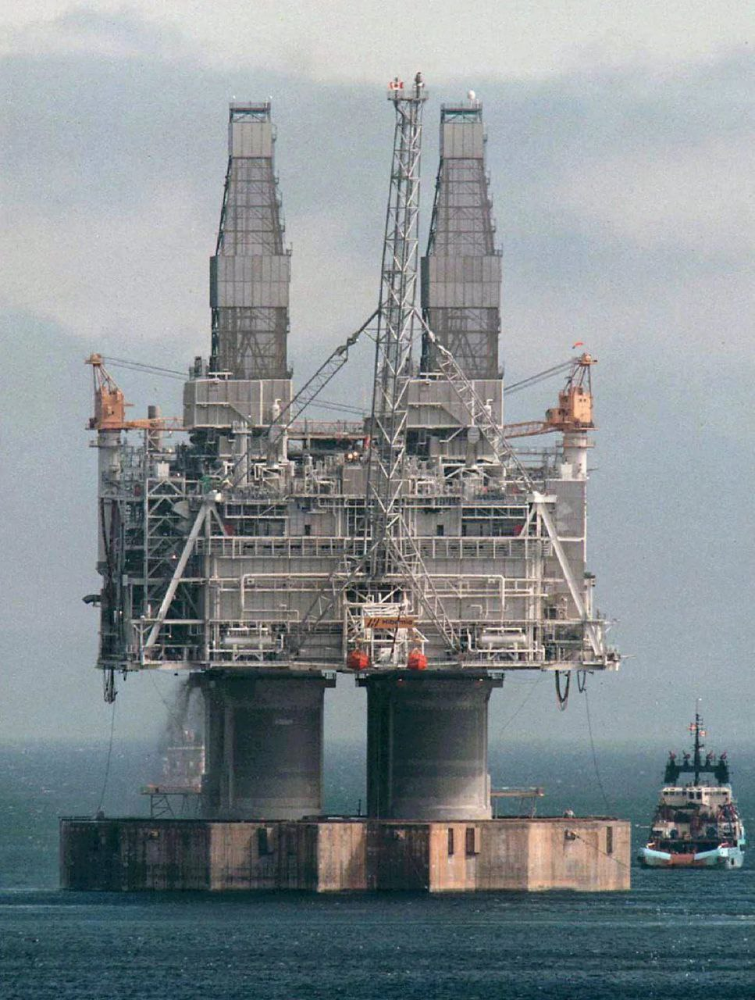
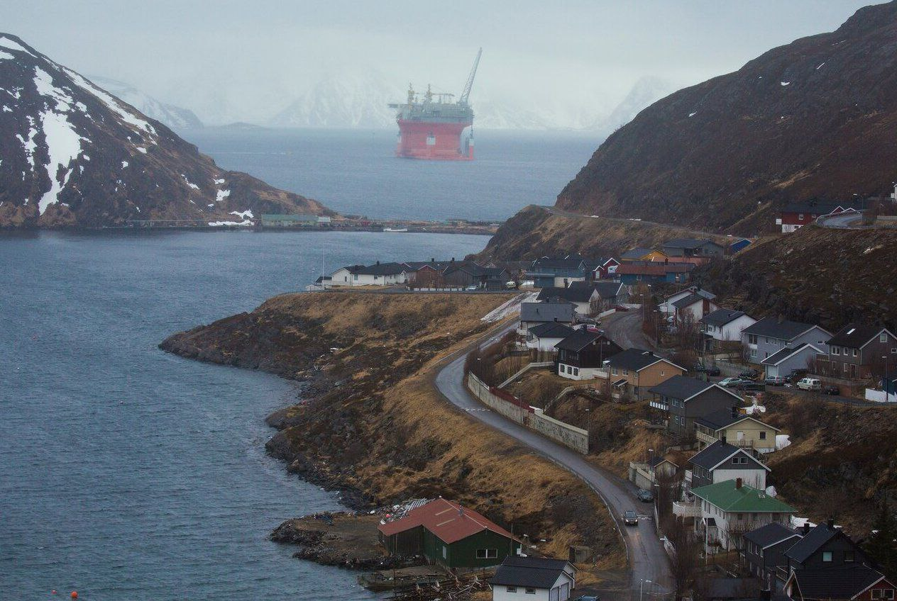
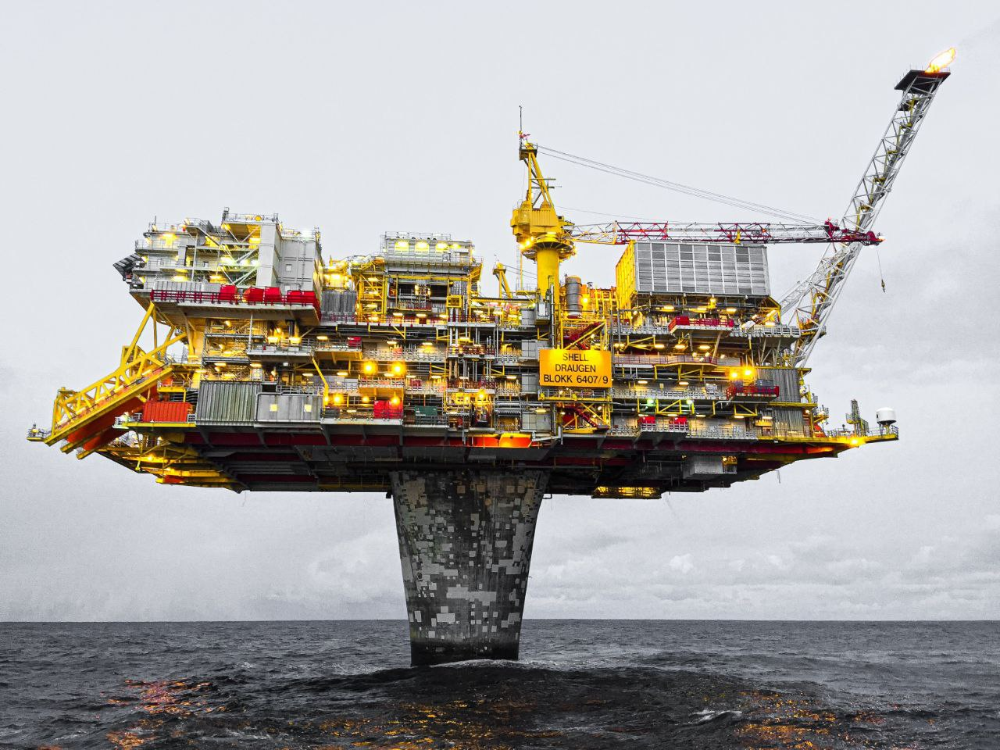
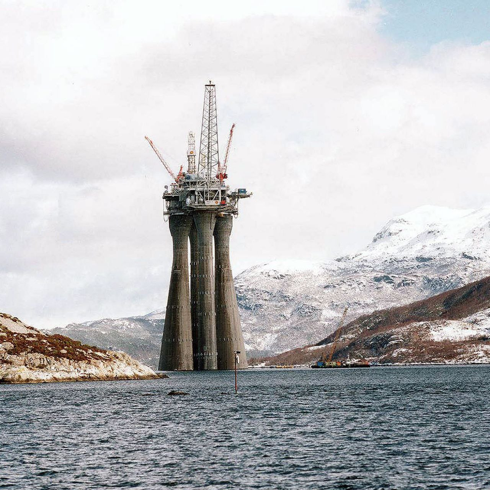
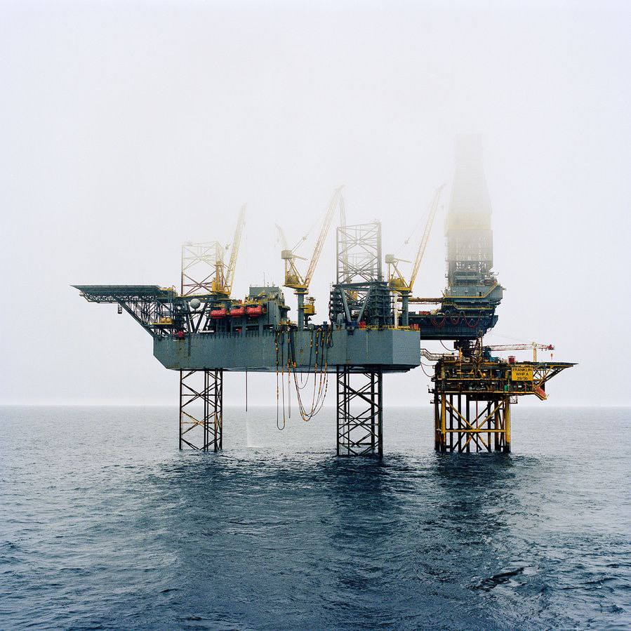
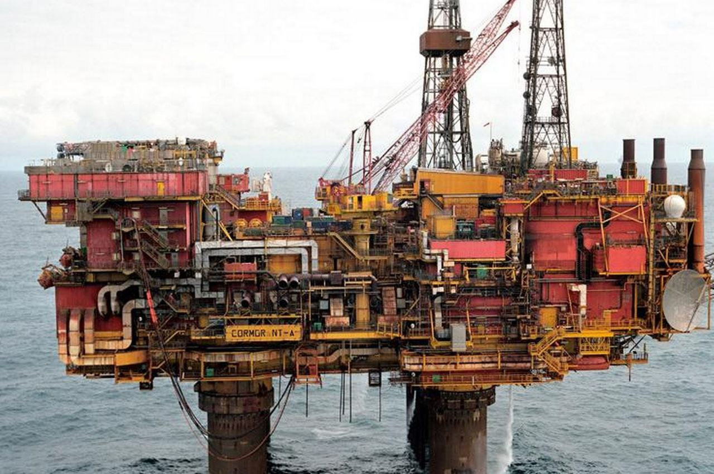
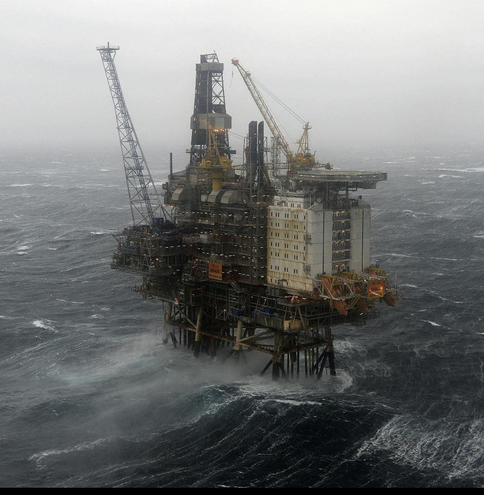

смотрел на дистопическую красоту нефтяных платформ и узнал, что многие установки [просто топят в океане ](https://youtu.be/Ot-UsUwhaec?feature=shared)

пока установка работает, морские организмы неизбежно крепятся к подводным частям платформы, а  когда месторождение исчерпает свои ресурсы, платформу перевозят в другое место, а опоры либо полностью кладут [на дно](https://en.wikipedia.org/wiki/Rigs-to-Reefs), либо распиливают пополами, тем самым создавая искусственные рифы, убежище для морских обитателей

и ещё большая часть живых организмов такого рифа возникает на буровой, а не заносится с других частей океана

win-win ситуация: экономия на демонтаже и выгода для окружающей среды
