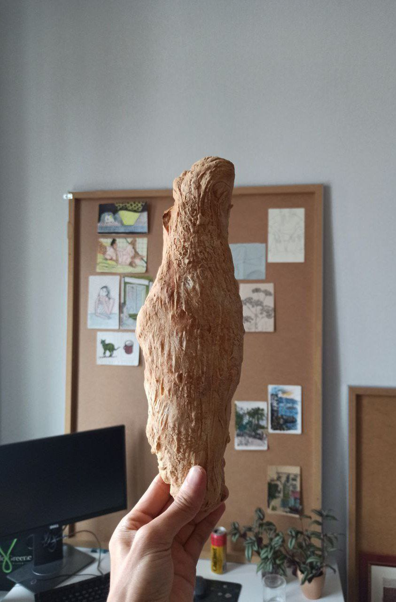

на выходных испёк свой первый в жизни хлеб, а точнее багет

проснулся в субботу с мыслью, что мне обязательно надо испечь багет\
вечером замесил тесто, а на следующее утро испёк

понадобилось минут десять, но можно справиться за пять

что нужно
- 475г муки
- 1 пакетик (7г) сухих активных дрожжей
- 1 чайная ложка соли
- 365мл воды

как готовить
1. перемешиваем муку и соль, потом добавляем дрожжи и воды
2. аккуратно месим всё, пока не станет всё цельным тестом
3. накрываем и оставляем на ночь, часов на 8-10
4. вываливаем тесто на поверхность, предварительно посыпав её мукой; на тесто не давим, чтобы воздушные пузыри не лопнули
5. делим тесто на два равных куска
6. и кладём на духовочную решётку, покрытую пергаментом
8. вытягиваем оба куска с двух сторон, чтобы было похоже на багет
9. печём на самой высокой температуре (у меня 250 градусов) в течение 25 минут на самой нижней полке

у меня получилось не похоже на багет, но хрустел так же (честно), и корка была толстовата\
в следующий раз я бы вытянул куски ещё длиннее, чтобы в центре не было толстоты\
и само тесто чуть меньшим количеством муки посыпал бы, оно запеклось на корке

Я. сказала, что это чиабатта

[видео-референс](https://youtu.be/Z-husjZkxHw)
