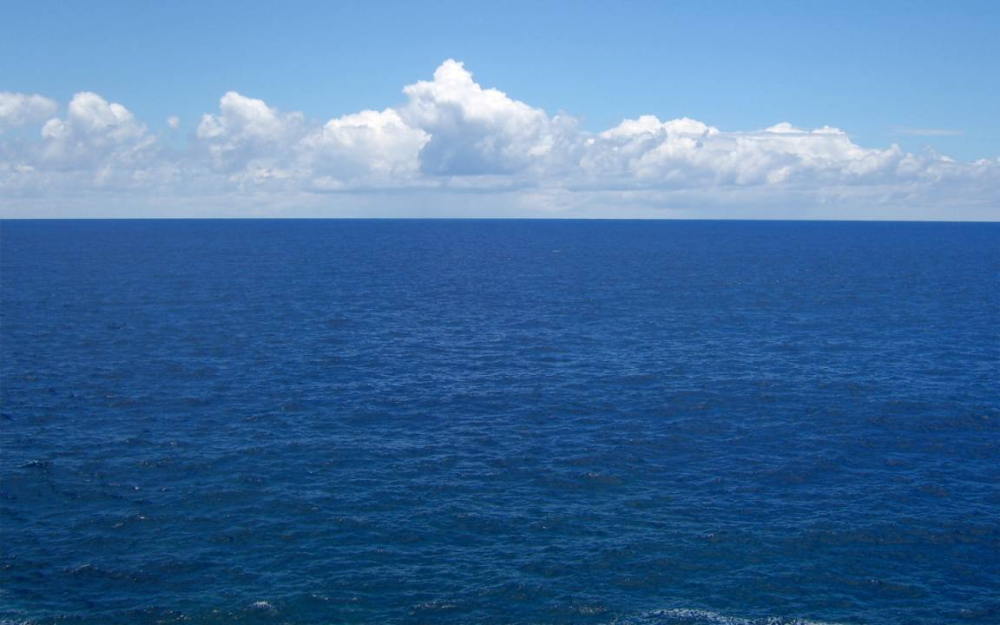

на работе появилась новая разработчица, которая в традиционном приветственном посте с тремя фактами о себе написала, что она профессиональный игрок в геогессер и ошибается максимум на пять метров

кто-то в комментариях оставил фото океана, снятое с борта корабля, где видно только, собственно, океан, небо и облака, мол, давай проверим, какой ты профессионал

а мне стало любопытно, что это за фотография и где её сделали, закинул её в гугл картинки, пролистал кучу страниц со ссылками на сео-статьи про путешествия, и нашёл страничку с дизайном начала нулевых, на которой есть только эта фотография

в заголовке было написано, что фото снято в открытых водах тихого океана рядом с гавайским островом, а в самом низу сайта был указан 2008 год

прикинул случайное место на гугл-картах вокруг гавайи и скинул в комментарии ссылку (оцениваю неточность в несколько сотен километров)

покоя мне это не дало, и я захотел узнать точные координаты, рядом с годом было имя и ссылка, ведущая на страницу профиля профессора математики в гавайском общественном колледже, с таким же старым дизайном

там я нашёл раздел about, там нашёл ссылку на резюме, и там нашёл электронную почту, на которую я написал письмо, где спросил не помнит ли он точное место той фотографии тихого океана

и на этом моменте тоже покоя я не нашёл, через пару часов я вернулся на страницу профессора побольше почитать о нём

у него несколько высших образований, работал в нескольких колледжах, закончил академию лётчиков, космическую программу для математиков, программу по ядерным энергиям, участвовал в красном кресте, гражданском воздушном патруле, астрономическом сообществе, гринпис, нко про доступное жильё, институт защиты животных...

потом я загуглил его полное имя и первая же ссылка вела на сайт гавайского мемориального парка и крематория, это была трибьют страница, посвещённая профессору

оказалось, что он умер в двадцатом году и ему было всего шестьдесят два года

тут я слегка приуныл\
от того, что я провёл столько времени, изучая человека и успел привязаться лично\
от того, что я написал письмо человеку, который уже никогда на него не ответит\
от того, что можно умереть так рано\
от того, что к своим годам у него столько всего в интересах, да ещё по большей части общественнозначимого

в общем, заставило задуматься (без грусти), а что я успел сделать за свою жизнь или что могу сделать
