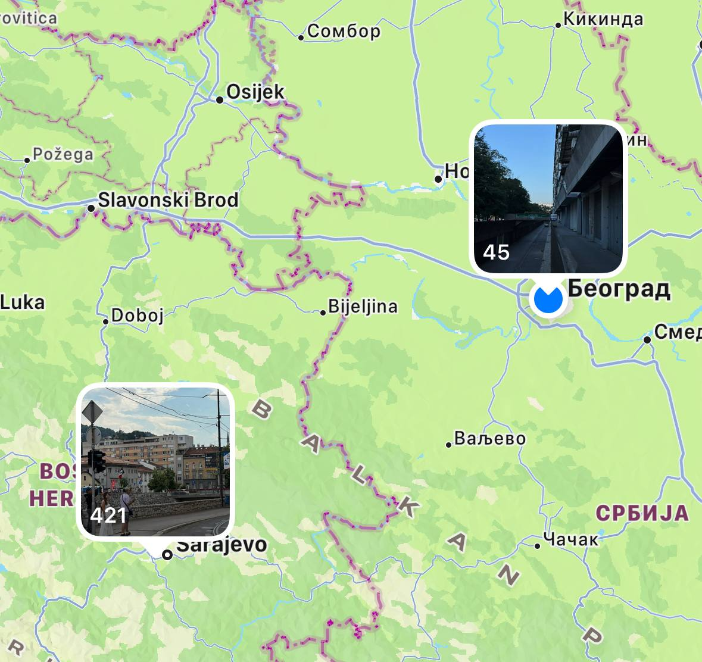

я тут в мини-отпуске, был в Сараево пару дней, а сейчас в Белграде столько же

Сараево, как по мне, намного красивее и аккуратнее, чем Белград\
в какой бы части города не был (а я бывал и на окраинах, и в частных секторах, не только в туристическом центре), там всегда хотелось что-то сфотографировать, хоть это исторические османские постройки, хоть это социалистический югославский спальник, хотелось всё разглядывать в деталях

в Белграде же, кроме заметных символов соцмодернизма, ничего сильно не привлекало внимание, но в плане городского устройства центральных и около районов, плотной застройки и возможности блужданий по ним, мне понравилось больше

при этом в Сараево я не увидел ни одного нефора, а это один из признаков прогрессивности города, наравне со спешалти кофейнями, которых в Сараево тоже нету
