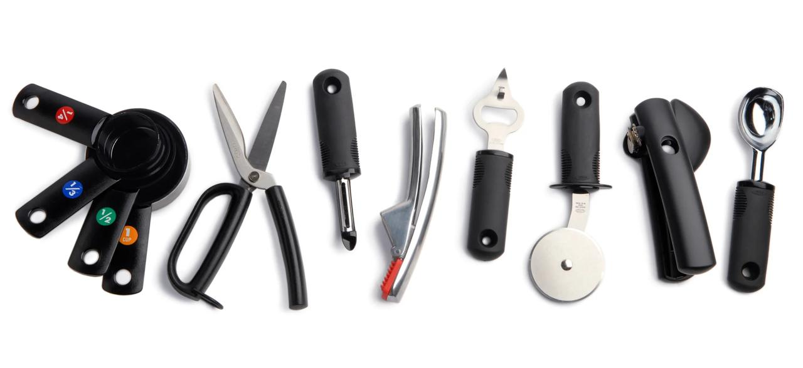

подумалось, что софт, а потом и любые вещи, станут более доступными, чем сейчас (от слова [accessibility](https://ru.wikipedia.org/wiki/%D0%94%D0%BE%D1%81%D1%82%D1%83%D0%BF%D0%BD%D0%BE%D1%81%D1%82%D1%8C)), потому что ии-агенты для управления компьютером и браузером уже используют тот же программный интерфейс, который используется специальными программами для чтения с экрана для слабовидящих или незрячих людей, и потенциально стандарты могут унифицироваться и подтянуться за этими новыми веяниями

а роботов делают в виде гуманоидов с руками и пальцами, и они скорее всего будут ещё долго медленными и неуклюжими, когда [придут в массовость](https://www.figure.ai/figure), и чтобы они помогали по дому эффективнее, посуду, приборы и любую бытовую технику будут делать под их медлительность, чтобы нажимать, держать, передвигать можно было проще, точнее и надёжнее, как для людей с ограниченной моторикой

а что доступно для меньшинства, то [удобнее для всех](https://ru.wikipedia.org/wiki/%D0%A3%D0%BD%D0%B8%D0%B2%D0%B5%D1%80%D1%81%D0%B0%D0%BB%D1%8C%D0%BD%D1%8B%D0%B9_%D0%B4%D0%B8%D0%B7%D0%B0%D0%B9%D0%BD)
