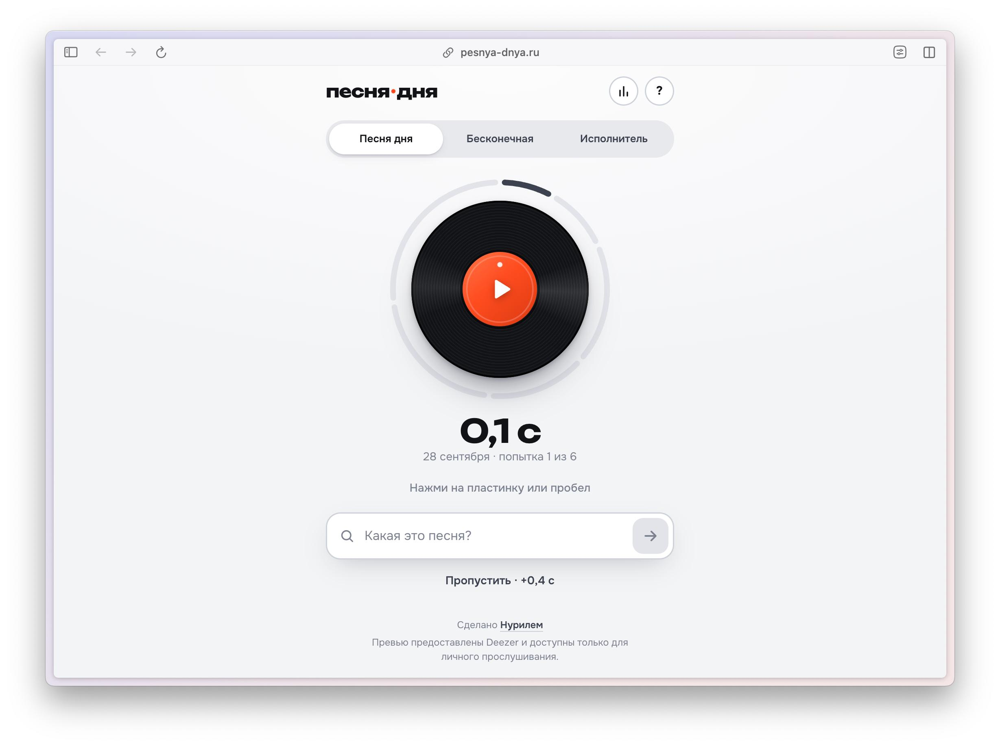

я сделал [музыкальную игру](https://pesnya-dnya.ru/)!\
это songless, только с песнями из российских стриминговых чартов

каждый день выбирается случайная песня дня, которую надо угадать за как можно меньший отрезок от 0.1 до 15 секунд

есть ещё два дополнительных режима:
- бесконечная игра, где можно выбрать жанр и играть (ага) бесконечно, угадывая случайные песни
- и исполнитель, где можно выбрать любого артиста/группу (необязательно русскоязычные) и проверить насколько хорошо знаешь его дискографию

в базе пока где-то полторы тысячи песен, которые были в топ-100 стримингов разных месяцев последних двух лет, но хочу добавить и другие десятилетия

велкам [https://pesnya-dnya.ru](https://pesnya-dnya.ru)!
